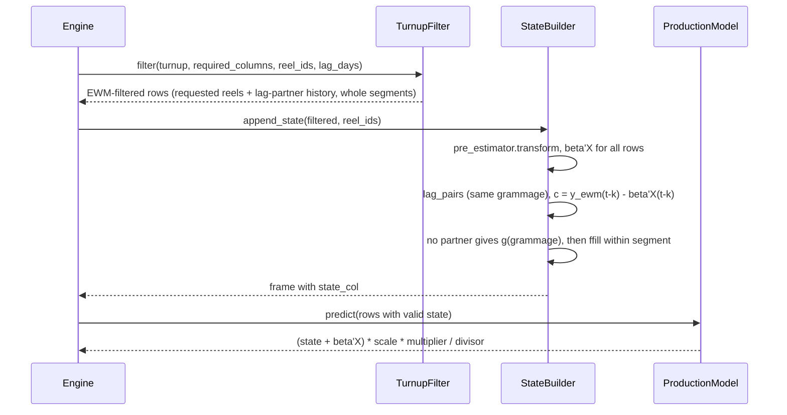

# Differencing Within a Grade, and Recovering the Absolute Prediction

The production models are trained on **differences**
`dy = y(t) - y(t-k)` against `dX = X(t) - X(t-k)`, where both rows belong to the
same grade (grammage) and the data were EWM-filtered per run. A difference model
alone does not give a level. This document explains how pairs are built, which
pairs are excluded, and how the stored model plus an observed past value of the
target gives the absolute prediction at inference time. Related documents:
[`model_building_overview.md`](model_building_overview.md),
[`feature_transformations_pls_ewm.md`](feature_transformations_pls_ewm.md),
[`experiments_framework.md`](experiments_framework.md).

Sources: `run_differencing_experiment.py` (`lag_pairs`, `main`),
`utility.py` (`StateBuilder`, `ProductionModel`, `load_state_and_prod`,
`TurnupFilter`), `explore_differencing_experiments.ipynb` (cells 23, 36 to 42),
`differencing_research.py`.

---

## 1. Why difference

From `differencing_research.py`: assume `y = f(X) + s(t) + eps` with a slowly
moving unobserved machine state `s(t)`. Then

```
y_t - y_{t-k} = f(X_t) - f(X_{t-k}) + (s_t - s_{t-k}) + noise,    (s_t - s_{t-k}) ~ 0 if s is smooth over k
```

Differencing is a fixed linear operator with no fitted parameters, removes level
shifts, and needs only that `s` is smooth over the lag. Combined with EWM it is a
band-pass: EWM removes variation faster than the halflife, the lag removes drift
slower than `k`. `differencing_research.block_contrast` (difference of window
means) is kept only to document that it was **rejected** (averaging removes the
independent fast variation between features, leaving collinear slow components).

---

## 2. Grade segments and EWM runs

"Grade" here is the `grammage` column (`AB_Grade_ID mod 1000`, possibly corrected
by `update_turnup_grammage`; only 85, 90, 100, 110, 115, 120 are kept).

Runs (segments) are identified identically in training and deployment:

```python
grade_change = grammage != grammage.shift()
time_gap     = index.diff() > 12h        # first row forced True
seg          = (grade_change | time_gap).cumsum()
```

(`main()`, `build_ci_differenced_frame`, `TurnupFilter.segments`,
`StateBuilder._ffill_within_segments`). The EWM restarts at every segment
boundary, so a filtered value never contains information from another grade or
across a gap longer than `12h`.

---

## 3. Building the pairs: `lag_pairs`

`run_differencing_experiment.lag_pairs(t_hours, lag_hours, tolerance=0.35, grammage=None)`
(identical logic in `StateBuilder._lag_pairs`, plus an optional second tolerance):

1. `t_hours` = hours since the first retained row (`to_hours`).
2. For each row `i`, find the row `j` whose time is **nearest** to
   `t_hours[i] - lag_hours` (`np.searchsorted`, then the closer of the two
   neighbours).
3. Keep the pair `(i, j)` only if
   - `j < i` (the partner is strictly earlier),
   - `|realised_lag - lag_hours| <= tolerance * lag_hours` with
     `realised_lag = t_i - t_j` (default `tolerance = 0.35`), and
   - when `grammage` is given (the default, i.e. unless
     `--allow_cross_grammage`): `grammage[i] == grammage[j]`.
4. The nearest row is the only candidate. A row is **not** paired with a second
   nearest same-grade row if the nearest one has another grammage (checked with
   `StateBuilder._lag_pairs` on a toy series).

What this excludes:

| Situation | Effect |
| --- | --- |
| Partner in another grade (grammage differs) | Pair dropped. This is the "within a grade only" rule; the reason given in the code is that a cross-grade difference measures a between-regime jump, a confounding source |
| Production gap (no row near `t - lag`) | The nearest row is far from the target time, `|realised - lag|` exceeds the tolerance, pair dropped. With `lag_days = 0.25` (6 h) the largest accepted realised lag is `1.35 * 6 = 8.1 h`, below the 12 h segment gap |
| Start of the record / of a run | No earlier row, pair dropped |
| Segment boundary | **Not** an explicit condition, see caveat 1 |

Per-run data are chosen by `--lag_days` (default `0.25`, 6 h). `DEFAULT_LAG_SWEEP = [0.05, 0.1, 0.25, 0.5, 1, 2, 4, 7, 14]` days is evaluated on train contrasts
only (skipped if fewer than 200 pairs) and written to `lag_sweep.csv`; it is
**informational**, the lag is not selected from it. Deployed lags: 0.1 d (Steam,
Starch top, Starch bottom) and 0.25 d (the others).

Then, in `main()`:

```python
X_all  = ts_transformed[feature_cols]                  # after FeatureCreator, PLS, scaler (level space)
y_all  = EWM-filtered target
later, earlier = lag_pairs(t_hours, lag_h, grammage=pair_grammage)
dX = X_all[later] - X_all[earlier]
dy = y_all[later] - y_all[earlier]
tr_sel = later <  split      # train contrasts
te_sel = later >= split      # test contrasts
```

`split = int(n_samples * 0.8)`. The earlier member of a test contrast may lie in
the training period; this is legitimate for a forecast anchored on an observed
past value. For the CI frame (`build_ci_differenced_frame`) the pairs are built
over **all** rows and rows with non-finite values are dropped; constant
columns are removed.

Cross-grade runs are possible only with `--allow_cross_grammage`; then
`grammage` is also kept as a one-hot feature (`include_grammage=True`).

Note: `differencing_research.lag_pairs` (research, evaluation by blocked CV) has
no grammage argument; the grade constraint exists in the production script, in
`StateBuilder` and, via EWM segments (`same_segment_only=True`), in
`ci_feature_selection.prepare_differencing_data`.

---

## 4. The difference model

- Features: the transformed, standardised level matrix `X_all[selected]`
  differenced; no grammage column; features are not centred per grade before
  differencing (`within_grade_centering: False` in the preparation metadata of
  `ci_feature_selection.prepare_differencing_data`; the main script does no
  per-grade centring either).
- `ridge` (default): `GridSearchCV(Pipeline[StandardScaler, Ridge], alpha in
  logspace(0, 4, 30), TimeSeriesSplit(5), neg RMSE)` on the train contrasts; the
  stored object is `best_estimator_`. The fitted function on a feature row `x` is

  ```
  f(x) = b + sum_j w_j * (x_j - mu_j) / sigma_j
  ```

  with `mu_j`, `sigma_j` the mean and scale of the **differenced** training
  features (the inner `StandardScaler` was fitted on `dX`) and `b` the Ridge
  intercept.
- Any other `--model` (splines, GP, GAM, hgbr, realmlp) also learns
  `dy = F(dX)`; the anchor construction below works for any `F`, but the
  per-grade baseline is only computed for linear models (`ridge`, `fs_ridge`).

The same `f` applied to level features (not differences) is what the deployed
`StateBuilder` and `ProductionModel` call `beta'X`:
`StateBuilder.estimator.predict(transformed[selected_features])`.

---

## 5. From differences to levels

### 5.1 The identity

For a pair `(t, r)` with `r = t - k` (`r` is the reference row, called
`earlier` in the code), and the EWM-filtered target `y~`:

```
dy_hat  = f(x_t) - f(x_r)                         (difference model, linear f: the intercept cancels)
y_hat_t = y~_r + dy_hat
        = [ y~_r - f(x_r) ]  +  f(x_t)
        =       c(t)         +  beta'x_t
```

- `c(t) = y~_r - f(x_r)` is the **state**: what the reference row's observed
  target contained beyond the regression (level of the grade, slow machine
  state, anything not explained by `X`).
- `beta'x_t = f(x_t)` is the regression part, the term operators can act on.
- In the notebook (cell 23): "beta'X(t) is regression (actionable), c(t) is
  state (context, not actionable)".

So the absolute model is **persistence plus the modelled change**: the anchor is
the observed past target, not a fitted intercept. Because `c` depends only on
the reference row, changing `x_t` (a what-if) moves `y_hat_t` by exactly
`f(x_t') - f(x_t)`.

Because the linear `f` contains `b` and the centring `mu/sigma`, both cancel in
`y_hat = y~_r + f(x_t) - f(x_r)` (see caveat 3 for the consequence).

### 5.2 Reference (anchor) selection

Per row, not per grade: the reference is the row found by `lag_pairs` (nearest
earlier row to `t - k`, same grammage, realised lag within tolerance). The
**grade baseline** is a per-grade fallback.

At deployment (`StateBuilder`, defaults from the bundle):

| Option | Value in the bundles | Meaning |
| --- | --- | --- |
| `tolerance` | `0.35` | first pass, as in training |
| `max_tolerance` | `1.0` | rows unresolved at 0.35 are retried with `|realised - lag| <= 1.0 * lag`; tight matches stay identical to strict matching |
| `fill` | `'ffill'` | carry the last resolved state forward within a segment, never across a grade change or `> gap_threshold` (`12h`) |
| `allow_cross_grammage` | `False` | partner must have the same grammage |
| `grade_baseline` | dict `{grammage: g}` | see below |

Training uses strict `tolerance = 0.35` only; the widened `max_tolerance`
partner is a deployment-time NaN reduction (a reference up to `2 * lag` back is
allowed) and is not evaluated in the training metrics.

### 5.3 Grade baseline `g(grammage)`

Because grammage is dropped as a feature after same-grade differencing, the
per-grade level has no home in `f`. It is stored as

```
g(G) = mean over rows of grade G of ( y~_t - f(x_t) )          (_compute_grade_baseline, ridge/fs_ridge only)
```

computed over train rows for `model.pkl` and over all rows for `model_full.pkl`.
Examples (from `deploy/` bundles): Steam `g` between 991.6 (grammage 120) and
1058.9 (grammage 90); `MBS_SCT_CD` 1.60 (85) to 2.11 (120); `MBS_CMT30` only
grades 100 (157.9) and 120 (194.4).

`StateBuilder.append_state` combines them (code order):

```python
state = g_row.copy()                          # default: baseline of the row's grammage (0.0 if unseen/none)
c_partner = y_ewm[earlier] - beta_x[earlier]  # state seen at the reference row
deviation = c_partner - g_row[later]          # deviation from the grade baseline
state[later] = g_row[later] + deviation       # == c_partner (identity written out)
```

So rows with a valid same-grade partner get `c(t)` exactly; rows without a
partner (cold start of a run, gap, no same-grade partner) get `g(grammage)`
only, i.e. `y_hat = g + f(x_t)`, a grade-average level rather than NaN.

### 5.4 Prediction

`ProductionModel.predict(df)`:

```python
state  = df[state_col]                          # raises ValueError if any NaN
beta_x = estimator.predict(pre_estimator.transform(df[feat_list])[selected_features])
result = (state + beta_x) * scale
if multiplier is not None: result *= multiplier_values
if divisor    is not None: result /= divisor_values
```

`scale`, `multiplier`, `divisor` support derived targets (the notebook shows
`Steam__kWh/T_ = Steam_power_corrected / Production_Rate__T/h_` with
`DIVISOR = 'Production_Rate__T/h_'` as an example; the multiplier/divisor
column may itself be created by `FeatureCreator` from filtered components). All
bundles in `deploy/` currently have `scale = 1.0`, `multiplier = None`,
`divisor = None`. The prediction is a prediction of the **EWM-filtered** target;
it is compared to the raw target in the round-trip checks
(`R2 vs raw`).

### 5.5 What is stored in the bundle

(See the overview, section 7.) The pieces that make reconstruction possible:

| Stored item | Role |
| --- | --- |
| `state_builder.pre_estimator` | FeatureCreator, PLS, filter, scaler (fitted on first 80% of training rows) |
| `state_builder.estimator` | `best_estimator_` (inner `StandardScaler` + `Ridge`) fitted on **all** contrasts (`model_full.pkl`) |
| `state_builder.selected_features` | Column order of the transformed features given to the estimator |
| `state_builder.grade_baseline` | `{grammage: g}` |
| `state_builder.lag_days`, `tolerance`, `max_tolerance`, `fill`, `gap_threshold`, `allow_cross_grammage` | Reference selection |
| `production_model` | `state + beta'X`, `scale`, `multiplier`, `divisor`, `feature_names_in_` (includes `state_col`) |
| `turnup_filter.pkl` (separate) | EWM at the model's halflife |

### 5.6 Inference flow



The target column must therefore be part of the **filtered input frame**
(`required_columns` contains every `y_column`), and the frame must reach back
at least one lag. For the incremental path the engine must pass `lag_days`
(use the maximum over models sharing one filtered frame) or `append_state`
returns baseline-only states.

---

## 6. Worked example

Take one grade (grammage 100), a scalar feature and a linear level function
`f(x) = 0.5 + 2x` (the `0.5` and the `2` stand for the fitted
`b - w'mu/sigma` and `w/sigma`). Lag `k = 6 h`. EWM-filtered rows:

| Row | t (h) | x | y~ | f(x) | y~ - f(x) |
| --- | --- | --- | --- | --- | --- |
| r0 | 0 | 10 | 100.0 | 20.5 | 79.5 |
| r1 | 6 | 12 | 105.0 | 24.5 | 80.5 |
| r2 | 12 | 11 | 103.0 | 22.5 | 80.5 |

Baseline: `g(100) = mean(79.5, 80.5, 80.5) = 80.17` (all three rows).

- **Pairs.** r1 pairs with r0 (realised lag 6 h), r2 with r1. r0 has no partner.
- **Difference model.** `dX = 2` gives `dy_hat = 2*2 = 4` for (r1, r0).
- **Absolute, r1.** `c(r1) = 100.0 - 20.5 = 79.5`, `y_hat = 79.5 + 24.5 = 104.0`.
  Same as `y~_r0 + dy_hat = 100 + 4`. Actual `y~(r1) = 105.0`, error `1.0`.
- **Absolute, r2.** `c(r2) = 105.0 - 24.5 = 80.5`, `y_hat = 80.5 + 22.5 = 103.0`
  (here exactly right). The anchor moves along with the observed series.
- **Cold start, r0.** No partner: `y_hat = g + f(10) = 80.17 + 20.5 = 100.67`,
  actual 100.0.
- **What-if on r2.** Set `x = 13` instead of 11 with the same state:
  `y_hat = 80.5 + f(13) = 80.5 + 26.5 = 107.0`, i.e. `+4 = 2 * (13 - 11)`.
- **Intercept cancels.** Replace `0.5` by `7.5`: `c(r1) = 72.5`, `y_hat = 72.5 + 31.5 = 104.0`.
  The constant in `f` does not affect partner-anchored predictions. It only
  shifts the cold-start value, which is re-centred by `g` (recomputed as
  `mean(y~ - f)`).

---

## 7. Evaluation of the differencing model

In `main()` after fitting (test contrasts only):

- `dy` metrics: `metrics(dy[te_sel], pred_test)`, with `pred_test` the **fitted
  difference model's** output (including its constant, see caveat 3).
- `persistence_ewm = y_all[earlier]`, `model_ewm = persistence_ewm + pred_test`.
- `raw`: `actual_raw_test = y_raw[later]`, `persistence_raw = y_raw[earlier]`,
  `model_raw = persistence_ewm + pred_test` (the model is still anchored on the
  EWM value, but scored against raw `y`).
- `gain_over_persistence_*` = R2(model) minus R2(persistence). Reading it:
  `R2(dy)` is the share of the within-grade change explained by `dX`; the gain
  is how much better the level prediction is than the "no change" forecast.

Notebook cell 23 re-derives the absolute model from the stored beta without
refit (`y_hat = c + beta'X`) and reports R2 against EWM and raw `y`; cell 38
runs the engine path (`TurnupFilter` then `StateBuilder` then `ProductionModel`)
against raw `y`.

---

## 8. Caveats / open questions

1. **Same grammage is not the same EWM segment.** The pairing rule requires
   equal `grammage` at both rows, and the EWM segment id changes whenever the
   grammage changes in between. A pair `(100 at 0 h, 90 at 1 h, 100 at 2 h, 100 at 6 h)`
   pairs rows 0 and 3 (checked with `StateBuilder._lag_pairs`: pair accepted)
   although a different-grade run lies between them, so the two filtered values
   come from different EWM segments with different warm-up. This is not excluded
   in `lag_pairs` or in `StateBuilder`. `ci_feature_selection.prepare_differencing_data`
   handles this with `same_segment_only=True`. How often it occurs in the data was
   not measured.
2. **Grade means `grammage` only**, not `AB_Grade_ID`/`paper_type`. Two paper
   types with the same grammage would not break a segment.
3. **The difference model's constant is not applied at deployment.** The
   training metrics use `pred_test`, which includes `f_diff(dX = 0)`:
   `b - sum_j w_j mu_j / sigma_j`. The deployed `y_hat = y~_r + f(x_t) - f(x_r)`
   contains only `sum_j (w_j / sigma_j) (x_t - x_r)_j`. Computed from the
   deployed estimators (`StandardScaler.mean_/scale_`, `Ridge.coef_/intercept_`),
   the dropped constant is, in target units: Steam +0.241, Electricity +0.006,
   Starch Top -0.003, Starch Bottom (0.25 d) -0.006, Starch Bottom (0.1 d) -0.002,
   SCT CD -0.001, SCT MD +0.001, Burst +0.193, CMT30 -0.008. Small compared with
   the levels but systematic per pair, so the stored `ewm_model`/`raw_model`
   metrics are not exactly the metrics of the deployed predictor. Not
   verified end to end on data.
4. **`grade_baseline` in `model_full.pkl` uses the train-only model**
   (`_compute_grade_baseline` reads `model`, called before `model_full` exists),
   see overview caveat 6. Affects only baseline-only (no partner) predictions.
5. **`fill='ffill'` is inert when a baseline exists.** `state` is initialised to
   `g_row`, so unresolved rows are already non-NaN and `_ffill_within_segments`
   has nothing to fill; the `append_state` docstring ("Unresolved edge rows get
   NaN") and the engine comment in notebook cell 42 ("NaN at edge rows, no error")
   describe the older behaviour. For a grammage without a baseline entry,
   `g = 0.0`, which would give `y_hat = beta'X` alone, a value far from the
   level (for Steam the baselines are about 1000).
6. **Stateful dependence on history.** Every prediction depends on an observed
   target value `~k` hours earlier in the same grade. If the target is not
   measured/available (or its history is not in the frame), no anchored
   prediction exists. For the widened `max_tolerance = 1.0` the reference can be
   up to `2k` back, a looser contrast than the one the model was trained on.
7. **Pair independence.** Consecutive contrasts share rows (each row is both a
   later and an earlier member) and EWM makes neighbours strongly correlated.
   Nothing in the training code adjusts for that (for example in CV or the
   reported R2).
8. **Lag versus halflife** (see the transformations document): the deployed
   lags (2.4 h, 6 h) are not larger than the 6 h EWM halflife, although the CLI
   help advises lag > 2 x halflife.
