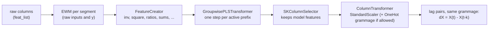

# Feature Transformations, PLS Grouping and EWM Filtering

This document describes how raw columns become model inputs: derived features
(`FeatureCreator`), scaling and encoding, **PLS grouping**
(`GroupwisePLSTransformer`) and **EWM filtering** (including the deployed
`TurnupFilter`). The differencing step that follows is in
[`differencing_and_absolute_reconstruction.md`](differencing_and_absolute_reconstruction.md);
the selection of variables is in
[`feature_selection_algorithms.md`](feature_selection_algorithms.md); the overall
pipeline is in [`model_building_overview.md`](model_building_overview.md).

## 1. Order of operations in `run_differencing_experiment.py`



Important detail: **EWM is applied to the raw inputs before `FeatureCreator`**
(`for col in feat_list: ... groupby(seg).transform(ewm_filter)` in `main()`), not
to the engineered columns. Engineered features (ratios, products, sums) are
therefore functions of filtered inputs. The EWM is *not* part of the stored
`pre_estimator` (`build_pre_estimator(apply_ewm=False)`); it is a data-prep step
in training and is re-implemented at deployment by `TurnupFilter`. The pipeline
stays row-local so it works on a single row at inference.

The pre-estimator (`feat`, PLS steps, `filter`, `scaler_encoder`) is fitted once
on the **first 80 percent of rows** (`pre_estimator.fit(ts_raw.iloc[:split], y_ewm.iloc[:split])`,
`TEST_SIZE = 0.20`) and then used to transform all rows. `model_full.pkl` reuses
that same pre-estimator; only the regression is refit on all contrasts.

---

## 2. Feature transformations

### 2.1 Derived features: `utility.FeatureCreator`

`FeatureCreator(features_to_create, features_to_keep, errors="raise")` builds
columns in dependency order (`_expand_with_deps`; `Fibre__g/m2_` needs
`Starch_uptake__g/m2_`, `Water_flow` needs `Water_flow_Predryer` and
`Water_flow_Afterdryer`). `features_required()` lists the raw inputs, which
become part of `feat_list`. Registry (`_registry`), raw inputs in
`_feature_raw_inputs`:

| Feature | Formula (as coded) |
| --- | --- |
| `delta_basis_weight` | `Current_basis_weight - grammage` |
| `Starch_uptake__g/m2_` | Top roll + Bottom roll uptake |
| `Fibre__g/m2_` | `Current_basis_weight * (1 - Current_reel_moisture_average(reel)/100) - Starch_uptake__g/m2_` |
| `temperature_starch_working_tank` | mean of `Temperature_starch_working_tank_1` and `_2` |
| `retention` | `1 - Consistency_white_water / (10 * Headbox_consistency)` |
| `dewatering` | sum of seven dewatering/uhle-box columns (`Dewatering_Shoe_press`, `Dewatering_Suction_Press_Roll`, `Dewatering_top_wire_suction_box_zone_2`, `Total_Dewatering_Press`, `Dewatering_First_Press_Roll`, `Uhle_box_1_flow___l/min_`, `Uhle_box_2_flow___l/min_`) |
| `fibre_short/long` | `Short_fibre_flow*Short_fibre_B06_consistency / (Long_fibre_flow*Long_fibre_consistency_B07)` |
| `Production_Rate__T/h_` | `Speed * Current_basis_weight * Current_reel_width * 60 / 1e8` |
| `inv_Production_Rate__T/h_` | `1 / (Speed * grammage * Current_reel_width * 60 / 1e8)` |
| `inv_Rod_Pressure_Bottom_Roll`, `inv_Rod_pressure_Top_Roll` | `_safe_inverse` (1/x, NaN where `|x| <= 1e-9`) |
| `square_Rod_Pressure_Bottom_Roll`, `square_Rod_pressure_Top_Roll` | `x ** 2` |
| `Water_Predryer`, `Water_flow_Predryer`, `Water_flow_Afterdryer`, `Water_flow`, `Water_Afterdryer_output`, `Water_flow_Afterdryer_input`, `Water_flow_Afterdryer_output` | Mass-balance style water terms from grammage, moisture tags and starch uptake (`Water_Predryer` uses `prod = 1` and `Water_Afterdryer_output` has no production factor; the `Water_flow_*` versions multiply by `Speed*grammage*Current_reel_width*60/1e8`; `moist_press = 50` is hard-coded in the pre-dryer terms) |
| `diluted_starch` | `uptake_top*(1-c2)/c2 + uptake_bottom*(1-c1)/c1` with the working-tank concentrations `c2`, `c1` |
| `flow_diluted_starch_index` | `(flow2/c2 + flow1/c1) / Production_Rate__T/h_` |

Which of these are used per target is defined by
`CREATED_VARIABLE_CANDIDATES[target]` in `run_differencing_experiment.py`; in CI
runs any selected name that is in the `FeatureCreator` registry is also routed
through creation (`_registry = FeatureCreator._registry()`), including PLS
sources that are engineered (for example `inv_Rod_Pressure_Bottom_Roll` in the
`starch1` group).

Other transformations in the code base:

- **Logarithm.** None applied to features or targets (searched the training
  code; `np.log` appears only inside penalty functions and CMA-ES popsize).
- **Splines.** Optional: `--model splines_ridge` puts
  `SplineTransformer(n_knots=6, degree=3, include_bias=False)` between the
  `StandardScaler` and Ridge (`--spline_knots`, `--spline_degree`). The legacy
  `feature_selection._fit_ridge(splines=True)` uses `n_knots=4, degree=2` on
  non-grammage columns.
- **Time lags of regressors.** `data_cleaning.make_design(df, ycol, ux, u_lags, y_lags=range(1,6))`
  can create `{u}_L{L}` and autoregressive `y_L{L}` columns. The research prep
  `data_prep_research.prepare` calls it with `u_lags=None` and
  `y_lags=range(1, 1+LAGS)` where `LAGS = 0`, so no lagged regressors are used.
  `run_differencing_experiment.py` does not call it. The only lag in the
  production pipeline is the differencing lag.
- **Outlier handling and clipping** are cleaning, not model transformations;
  see the overview.

### 2.2 Scaling and encoding

Last step of `build_pre_estimator`: a `ColumnTransformer` named `scaler_encoder`
(`set_output(transform="pandas")`, `remainder="drop"`):

- numeric features: `StandardScaler` (fitted on the first 80 percent of
  **level** data);
- `grammage` (only if `include_grammage=True`): `OneHotEncoder(handle_unknown="ignore", sparse_output=False, drop="first")`.

In differencing runs `include_grammage=args.allow_cross_grammage`, which is
`False` by default, so no grammage columns exist. After the pairing step the
Ridge pipeline applies a **second** `StandardScaler` fitted on `dX`
(`build_ridge_model`). The fitted regression therefore operates on features that
were standardised on levels and then re-standardised on differences. Because both
are linear, the level-space prediction function used at deployment is still
linear in the inputs (see the differencing document).

### 2.3 Exclusion rules applied before transformation

- Any variable whose name contains `vacuum` is dropped from the direct feature
  list.
- Columns matching `cylinder.*steam_pressure` and `cylinder.*differential_pressure`
  are not direct features; they reach the model through the `steam_pressure`
  PLS group (configured for `Steam_power` only).
- `BLACK_LIST[target]` removals.

---

## 3. PLS grouping

### 3.1 Groups: `preprocessing._PLS_REGISTRY`

Each key is a *prefix*; the transformer emits scores named `<prefix>_1 ... <prefix>_n`.

| Prefix | Source list (`config.py`) | n components | Active in `PIPELINE_PREFIXES` for |
| --- | --- | --- | --- |
| `steam_pressure` | `STEAM_PRESSURE_VARS + STEAM_DIFF_PRESSURE_VARS` (cylinder steam and differential pressures) | 4 | `Steam_power`, `Steam_power_corrected` |
| `exha_mois` | `EXHAUST_MOISTURE_VARS` (DG1, DG2, DG4, DG5 outlet-air moisture) | 2 | `Steam_power(_corrected)`, `Steam__kWh/T_` (not in CI) |
| `inlet_temp` | `INLET_TEMP_VARS` (DG1 to DG5 inlet-air temperature) | 2 | all three Steam targets |
| `vacuum` | `VACUUM_VARS` | 4 | `Steam_power(_corrected)` |
| `linepressure` | `LINEPRESSURE_VARS` (5 press line pressures) | 2 | Steam targets, both Electricity targets, starch rolls |
| `fabric_tension` | `FABRIC_TENSION_VARS` | 1 | Steam targets |
| `gas_decu` | `GAS_DECULATOR_VARS` | 3 | Steam targets |
| `speedsizer_linepressure` | `SPEEDSIZER_LINEPRESSURE_VARS` (DS, FS) | 1 | Electricity targets, starch rolls, `MBS_*` |
| `starch2` | `STARCH_TOP_VARS` | 3 | `Starch_..._Top_Roll` |
| `starch1` | `STARCH_BOTTOM_VARS` | 3 | `Starch_..._Bottom_Roll` |
| `conc_starch` | `CONC_STARCH_VARS` | 1 | `MBS_*` (non-CI only) |
| `draw` | `DRAW_VARS` | 2 | commented out in the differencing script (still in `data_prep_research.py`) |
| `draw_speed`, `vacuum_speed` | `SPEED_VARS + DRAW_VARS`, `VACUUM_VARS + ["Speed"]` | 4, 4 | not configured for any target |

CI runs use `CI_PIPELINE_PREFIXES[target]` instead (falling back to
`PIPELINE_PREFIXES`). Differences: `Steam__kWh/T_` drops `exha_mois`;
`MBS_*` keep only `speedsizer_linepressure` (no `conc_starch`); the rest equal
the non-CI lists. Other scripts define their own `PIPELINE_PREFIXES` (see the
feature-selection document, caveat 4).

`make_prep_pip(prefixes)` returns a `Pipeline` of
`GroupwisePLSTransformer(pls_columns, n_components, score_prefix=prefix, remainder="passthrough")`
steps (no `group_col`, so **one global PLS per group**, not one per grammage) and
the list of raw source columns consumed. An unknown prefix raises `ValueError`.

### 3.2 What the transformer does (`utility.GroupwisePLSTransformer`)

- `fit(X, y)`: `y` is required (the projection is **supervised**).
  `n_components_ = min(n_components, n_source_columns, n_rows - 1)`.
  `_fit_single_bundle`: `StandardScaler` on the source columns (`scale=True`),
  then `sklearn.cross_decomposition.PLSRegression(n_components)` fitted to `y`.
- `transform(X)`: standardise sources, `pls.transform` to get scores, emit
  `<prefix>_1..n`, pass through all other columns (`remainder="passthrough"`),
  source columns are consumed (removed from the output).
- If `group_col` were given there would be one PLS per group value with a global
  fallback (`handle_unknown_group="global"`); the pipeline never sets it.

The target given to `fit` in the differencing script is the **EWM-filtered level
of `y`** over the first 80 percent of rows (`pre_estimator.fit(ts_raw.iloc[:split], turnup_ts[Y].iloc[:split])`),
not `dy`. The CI frame builder does the same.

### 3.3 How groups feed the model

1. `make_prep_pip(prefixes=active_prefixes)`.
2. `exog_vars_reduced` is built from the control variables; for every PLS step
   the score names (`prefix_1..n`) are added and the group's source columns are
   removed (`ordered_difference(..., step.pls_columns)`). In CI runs only the
   scores CI kept are added, and a group CI rejected completely is not added
   (see [`ci_feature_selection.md` section 11](ci_feature_selection.md)).
3. `build_pre_estimator`:
   - a PLS step is included in the pipeline only if at least one of its scores
     is in the model feature list (`features_to_keep_filter`);
   - the raw **sources** of an active group are added to `features_to_keep_feat`
     (so they enter `feat_list`, get EWM-filtered, and are available for the PLS
     step), while the scores replace them in the column filter;
   - the `filter` step (`SKColumnSelector`) keeps only the model features, so a
     fitted group that emits `n` scores can contribute fewer than `n` columns.
4. Scores are standardised by `scaler_encoder` like any other numeric feature
   and then differenced as part of `X`.

Because every step (`StandardScaler`, `PLSRegression.transform`, EWM) is linear
in the inputs, `PLS(x_t) - PLS(x_{t-k})` equals the PLS projection of the source
differences (up to the centring constant, which cancels). The linear structure
is what makes the deployed level function `beta'X` consistent with the
differenced fit.

`prune_pre_estimator` (used for `fs_ridge`) removes groups whose scores are all
unselected; `data_prep_research.pls_feature_groups` exposes the score groups as
all-or-nothing atoms for CMA-ES.

### 3.4 Deployed examples (from the bundles)

`state_builder.pre_estimator.steps`:

| Bundle | Steps |
| --- | --- |
| Steam | `feat`, `inlet_temp`, `filter`, `scaler_encoder` (selected includes `inlet_temp_2`) |
| Electricity, SCT CD/MD, Burst, CMT30 | `feat`, `filter`, `scaler_encoder` (no PLS group in the fitted model) |
| Starch Uptake Top | `feat`, `starch2`, `filter`, `scaler_encoder` (selected: `starch2_1..3`) |
| Starch Uptake Bottom (both) | `feat`, `starch1`, `filter`, `scaler_encoder` (selected: `starch1_1`) |

---

## 4. EWM filtering

### 4.1 The filter

`run_differencing_experiment.ewm_filter(s, halflife)`:

```python
out = s.ewm(halflife=halflife, times=s.index, adjust=True).mean()
if len(s) >= 2:
    out.iloc[0] = (s.iloc[0] + s.iloc[1]) / 2.0     # softened start
```

- `times=s.index` makes the halflife a **time** quantity: a gap in the data
  decays the weights by elapsed time, not by number of rows.
- `adjust=True` uses normalised weights, so the filtered value at the start of
  a segment is a weighted mean of the available rows.
- The first value in each segment is replaced by the mean of the first two raw
  values. This uses a *newer* row, so the oldest row of a segment is not causal;
  every other filtered value depends only on that row and older rows of the same
  segment (`TurnupFilter` docstring).

Identical implementations exist in `utility.ewm_reset` (hard-coded `halflife="120min"`),
`data_prep_research.prepare` (`ewm_halflife="120min"` default), `ci_feature_selection.ewm_filter`
(default `"6h"`), `preprocessing.EWMSegmentFilter` and `utility.TurnupFilter._ewm_segment`.

### 4.2 What is filtered

- In `main()`: every numeric column of `feat_list` (the raw inputs of the
  pre-estimator, including raw PLS sources) **and the target**, always
  (`results.json` records `apply_ewm_filter: true`, `apply_ewm_filter_y: true`
  as constants). Metrics are reported both against the EWM `y` and against raw
  `y`; `y_raw` is kept.
- The saved `turnup_ts.parquet` is the EWM'd frame, `turnup_ts_raw.parquet` the
  pre-EWM frame.
- Deployed: `TurnupFilter.filter_all(turnup_raw, columns)` filters the columns
  the caller names (the manifest's `required_columns`, i.e. all models'
  `feat_list` plus target columns), returning them with `MBS_Current_reel_ID` as a column.

### 4.3 Segments: where the filter resets

```python
grade_change = grammage != grammage.shift()
time_gap     = index.diff() > 12h            # first row forced True
seg = (grade_change | time_gap).cumsum()
```

Each segment is filtered independently (`groupby(seg).transform`). So the EWM
never mixes values across a grammage change or a production gap larger than
`12h` (`gap_threshold`, hard-coded as `pd.Timedelta("12h")` in the script and
`gap_threshold="12h"` in `TurnupFilter`). Segmentation happens **after** rows
with NaN in the target or required inputs were dropped, so removing rows can
merge or shorten segments.

### 4.4 Halflife choice

In `run_differencing_experiment.py` (`main()`):

- `--ewm_halflife` is an **integer number of hours**; `0` (default) means
  `ewm_halflife_hours = lag_hours / 3` ("band-pass" rule in the code comments:
  EWM removes noise faster than the halflife, differencing removes drift slower
  than the lag).
- The value is turned into a string: hours `>= 1` become `"6h"` (or `"2.4h"`),
  smaller values become minutes (`"48min"`). For example `--lag_days 0.25` with
  the default gives `"2h"`, `--lag_days 0.1` gives `"48min"`.
- `run_all_differencing.py` passes `--ewm_halflife` from `EWM_HOURS`, currently
  `[6]`, so the stored runs use `"6h"`.
- The halflife is stored in `results.json["parameters"]["ewm_halflife"]` and in the
  bundle (`ewm_halflife`). The notebook's deploy cell warns if a model's halflife
  differs from the shared filter's (`EWM_HALFLIFE = "6h"`), because the state
  would be inconsistent.

Other scripts use other defaults: `120min` in the legacy level scripts and
`utility.ewm_reset`. The `data_prep_research.prepare` docstring argues that
120 minutes is only about 2.3 times the median reel spacing (52 min), giving
about 7 effective samples and removing about 10 percent of target variance, and
that variance removal plateaus near 13 percent at an 8 to 12 h halflife; it
recommends sweeping rather than assuming.

### 4.5 The deployed turnup filter (`deploy/turnup_filter.pkl`)

`utility.TurnupFilter(halflife, grammage_col="grammage", gap_threshold="12h", time_col="Wedge_Time", id_col="MBS_Current_reel_ID")`.
(The name refers to the turn-up/reel dataset; the reel id column is the
selection key.) Methods:

- `filter_all(turnup_raw, columns)`: full-frame filter, the "source of truth".
- `filter(turnup_raw, columns, reel_ids, lag_days=None)`: returns the requested
  reels **plus** the history needed for their state: it covers the time span
  from `earliest_requested - 1.5 * lag` to the latest request, includes every
  *whole* segment touching that span (so the EWM is exact) and filters each
  once.
- `segments(frame)`: same segmentation as training.

One filter object, one halflife, shared by all models, hence the hard
requirement that every deployed model was trained at that halflife
(`manifest["ewm_halflife"]`). Notebook cell 41 checks `filter` against
`filter_all` and the engine path against the all-in-one path; differences of
the order `1e-6` are expected, and the oldest row of each segment is excluded
from the comparison because of the softened start.

### 4.6 `preprocessing.EWMSegmentFilter` (not used for differencing)

An sklearn transformer with `grade_col="AB_Grade_ID"`, `gap_threshold="12h"`,
`halflife="120min"`, `exclude_patterns=["y_L"]`. It detects segments from
`AB_Grade_ID` changes and gaps, filters numeric columns and drops the grade
column. It is only inserted when `build_pre_estimator(apply_ewm=True)` is
called (legacy scripts with `--apply_ewm_filter`).
`run_differencing_experiment.py` passes `apply_ewm=False` and segments by
`grammage` instead of `AB_Grade_ID`.

---

## 5. Caveats / open questions

1. **PLS is fitted against the level of `y`, then used for differences.** The
   components are chosen to covary with the EWM-level target (including
   between-grade level differences and drift) on the first 80 percent of rows,
   not with `dy` within grade. Whether this is the best projection for the
   within-grade differencing model is not evaluated in the code.
2. **Source lists include other targets/quality outcomes.** `STARCH_TOP_VARS`
   and `STARCH_BOTTOM_VARS` contain `MBS_SCT_CD`; `CONC_STARCH_VARS` contains
   `Starch_uptake__g/m2_` (itself created from the two roll uptakes). Both
   deployed starch bundles list `MBS_SCT_CD` among their `input_features`.
3. **`vacuum` group.** Vacuum columns are removed from direct features but are
   used as PLS sources for the `vacuum` group (only for `Steam_power(_corrected)`).
4. **Two parallel `PIPELINE_PREFIXES` for CI.** CI runs use
   `CI_PIPELINE_PREFIXES`; conclusions about which PLS groups exist depend on
   which dictionary was active when a run was made. The run's `results.json` does
   not record the prefix list; the active groups can be read from
   `model.pkl["pre_estimator"].steps`.
5. **Halflife vs lag.** The CLI help recommends a lag longer than twice the
   halflife; the deployed configuration (halflife 6 h, lags 2.4 h and 6 h) does
   not follow that. The effect on identification is not examined here.
6. **Non-causal first row of a segment** (softened start) and
   **engine/training row-set differences** (training drops rows before
   segmentation) mean the first filtered rows in a segment can differ between
   training and deployment.
7. **Engineered features use `prod = 1`** in `Water_Predryer` and
   `diluted_starch` (the production factor is commented out), unlike the
   `Water_flow_*` versions that include it. Whether this is intended per
   feature is not stated.
