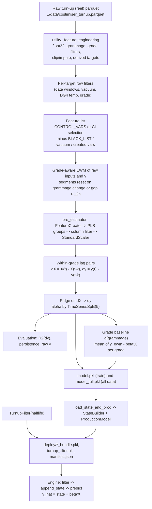

# Model Building Overview

This is the entry point for how the models in `training/` are built, evaluated,
bundled and deployed. It describes what the code in the workspace actually does
(file names, function names, config keys and defaults are quoted from the
source). Where the code is unclear or inconsistent, the point is collected in
the **Caveats / open questions** section at the end rather than guessed.

The production approach is a **differencing model**: a (mostly Ridge) regression
of `y(t) - y(t-k)` on `X(t) - X(t-k)`, where both members of every pair come from
the same grade (grammage) and the same EWM-filtered run. At deployment the
differencing model is turned back into an **absolute (level) predictor** by
anchoring on an observed past value of the target. The older level models
(iterative backfitting with a local level) and several research scripts are
described briefly so the folder structure makes sense.

## Index

| Document | What it covers |
| --- | --- |
| [`model_building_overview.md`](model_building_overview.md) (this file) | Pipeline, data, targets, cleaning, training, evaluation, bundles, manifest, caveats |
| [`feature_selection_algorithms.md`](feature_selection_algorithms.md) | Every feature-selection mechanism in the code: curated lists, CI search, mutual information, CMA-ES, mediator exclusion, ... |
| [`ci_feature_selection.md`](ci_feature_selection.md) | Deep dive into the conditional-independence (CI) search (existing document, not repeated here) |
| [`feature_transformations_pls_ewm.md`](feature_transformations_pls_ewm.md) | Derived features, scaling, PLS grouping, EWM filtering, the deployed turnup filter |
| [`differencing_and_absolute_reconstruction.md`](differencing_and_absolute_reconstruction.md) | Within-grade differencing, and how the difference model yields absolute predictions (math, worked example, bundle storage) |
| [`experiments_framework.md`](experiments_framework.md) | `run_differencing_experiment.py`, `run_all_differencing.py`, outputs, comparing runs |

---

## 1. Pipeline at a glance



Step by step:

1. **Data and targets** (section 2): reel-level parquet, `_feature_engineering`.
2. **Row filtering** per target (section 3).
3. **Feature list** from `config.CONTROL_VARS[target]` or, with
   `--conditional_independence`, from the CI search (section 5).
4. **EWM filtering** of raw inputs and the target, segment-wise
   ([`feature_transformations_pls_ewm.md`](feature_transformations_pls_ewm.md)).
5. **Pre-estimator** built by `preprocessing.build_pre_estimator`
   (derived features, PLS groups, column filter, scaling).
6. **Differencing** at a time-based lag, same grammage only
   ([`differencing_and_absolute_reconstruction.md`](differencing_and_absolute_reconstruction.md)).
7. **Model fit**, evaluation, grade baseline, artefacts (section 6).
8. **Bundling and deployment** (section 7).

---

## 2. Data sources and targets

### 2.1 Data

- Input is one parquet file with one row per reel turn-up, indexed by
  `Wedge_Time` after `_feature_engineering` (`utility.py`). `MBS_Current_reel_ID`
  and `AB_Grade_ID` are kept as columns. The path is passed as `--data_path`.
  The scripts disagree on the file name (`../data/costimiser_turnup.parquet` in
  `run_all_differencing.py` and the notebooks, `costimier_turnup.parquet` in the
  docstrings, `README.md` and several research scripts); see caveats.
- `utility._feature_engineering(turnup, setpoint_df, steam_null, clip=True)`:
  - casts every column except `MBS_Current_reel_ID`, `AB_Grade_ID`, `Wedge_Time`
    to `float32`;
  - `grammage = AB_Grade_ID mod 1000`, `paper_type = AB_Grade_ID // 1000`;
  - keeps grammage in `[85, 90, 95, 100, 110, 115, 120, 125, 130, 135]` and
    paper types `3200`, `6010`, `3300`;
  - `update_turnup_grammage(...)` re-labels grammage when the measured
    `Current_basis_weight` persistently disagrees with it (targets
    `(85, 90, 100, 110, 115, 120)`, `tolerance=4.5`, `persist_n=3`);
  - with `clip=True` (used by `run_differencing_experiment.py`) impute values
    outside physical limits with the **grade median**
    (`impute_outside_limits_with_grade_median`; e.g. `Production_Rate__T/h_` to
    `[45, 75]`, draws, speeds `[950, 1400]`, quality targets `MBS_SCT_MD`
    `[2.2, 4.5]` and `MBS_SCT_CD` `[1.4, 2.4]`). `data_prep_research.prepare`
    calls it with `clip=False`.
- After this every script keeps only `grammage in [115, 120, 100, 90, 85, 110]`
  (`GRAMMAGES`).

### 2.2 Targets

| Target (`--y_column`) | Meaning / construction | Source |
| --- | --- | --- |
| `Steam_power`, `Steam_power_corrected` | `Steam_power = Steam_flow_to_PM + Waste_steam_flow`; `Steam_power_corrected = ((Steam_power*0.788 - cond)*1.02 - 0.5938/24)*1000`, where `cond` is `Condensate_energy_from_paper_plant_to_power_plant` clipped to `[0, 10]` (median, fallback `5.11`, outside) | `_feature_engineering` |
| `Steam__kWh/T_` | `Steam_power_corrected / Production_Rate__T/h_` (specific steam) | `_feature_engineering` |
| `Electrical_power_MW` | Sum of drive/plant power tags divided by 1000 | `_feature_engineering` |
| `Electricity__kWh/T_` | Specific electricity (column of the data) | data |
| `Starch_uptake_by_paper_Top_Roll__g/m2_`, `..._Bottom_Roll__g/m2_` | Starch uptake per roll, outliers cleaned by IQR per `AB_Grade_ID` and forward filled | data + `_feature_engineering` |
| `Starch_uptake__g/m2_` | Top + Bottom. A feature, not a deployed target, and a FIXED variable for several targets | `_feature_engineering`, `FeatureCreator` |
| `MBS_SCT_CD`, `MBS_SCT_MD`, `MBS_Burst`, `MBS_CMT30` | Paper strength quality properties. `MBS_CMT30` is only defined for grades `6010100` and `6010120` (set to 0 for others, so the scripts filter on those two grades) | data + `_feature_engineering` |

The deployed engine names are in the manifest (`Steam`, `Electricity`,
`Starch Uptake Top`, `Starch Uptake Bottom`, `SCT CD`, `SCT MD`, `Burst`, `CMT30`).

### 2.3 Predictor pools

| Object | Defined in | Role |
| --- | --- | --- |
| `CONTROL_VARS[target]` | `config.py` | Hand-curated predictor list used when CI is **off** |
| `CONSIDERED_VARS[target]` | `config.py` (built from `_BASE_CONSIDERED_VARS` by removal loops) | Candidate pool searched when CI is **on** |
| `FIXED_VARIABLES[target]` | `config.py` | Variables always kept (CI runs). Default `_DEFAULT_FIXED = ["Starch_uptake__g/m2_", "Jet/wire_ratio"]` |
| `BLACK_LIST[target]` | `run_differencing_experiment.py` | Variables removed from the raw feature list (e.g. `Bentonite_*`, `CO2_mass_flow__g/T_`, `Lip_settings`, pH and conductivity tags for the energy targets) |
| `CREATED_VARIABLE_CANDIDATES[target]` | `run_differencing_experiment.py` | Names built by `FeatureCreator` rather than read as columns |
| `PIPELINE_PREFIXES` / `CI_PIPELINE_PREFIXES` | `run_differencing_experiment.py` | Which PLS groups are active (section 4 of the PLS document) |

---

## 3. Cleaning and grade handling

- **Row filters per target.** `run_differencing_experiment.py` (`main`) applies
  inline date windows and operating-state filters. All targets exclude
  `2026-01-24 07:00 .. 2026-01-26 10:00` (not `Electricity__kWh/T_`, see caveats).

  | Target | Filter (all strict inequalities on the index) |
  | --- | --- |
  | `Steam_power`, `Steam_power_corrected`, `Steam__kWh/T_` | `> 2026-1-1`, `< 2026-7-1`; also drop `2026-01-11 12:00..01-12 11:00` and `2026-01-17 12:00..01-19 11:00`; `DG4_Temperature_Inlet_Air > 100` and `Vacuum_Zone_1_PickUp < -0.5` |
  | `Electrical_power_MW` | `> 2025-11-15`, `< 2026-7-1`, `Vacuum_Zone_1_PickUp < -0.5` |
  | `Starch_uptake_by_paper_Top_Roll__g/m2_` | `> 2026-3-1`, `< 2026-7-1`, `Vacuum_Zone_1_PickUp < -0.5` |
  | `Starch_uptake_by_paper_Bottom_Roll__g/m2_` | `> 2026-2-1`, `< 2026-7-1`, `Vacuum_Zone_1_PickUp < -0.5` |
  | `MBS_SCT_CD` | `> 2025-11-15`, `< 2026-7-1` |
  | `MBS_SCT_MD`, `MBS_Burst` | `> 2026-02-01`, `< 2026-7-1` |
  | `MBS_CMT30` | as above plus `AB_Grade_ID in {"6010120", "6010100"}` |

  `data_prep_research._apply_target_filters` and
  `ci_feature_selection.filter_training_period` implement similar but not
  identical filters (different start dates for some targets; no upper bound in
  the former).
- **Grade filter.** `grammage in [115, 120, 100, 90, 85, 110]`.
- **NaN handling.** Rows with NaN target and NaN in any required raw input
  (`feat_list`) are dropped before EWM filtering.
- **Grade handling in the model.** "Grade" in the differencing code means the
  `grammage` column, not the full `AB_Grade_ID`. Grammage is used for EWM
  segmentation, for the same-grade pairing constraint, and for the per-grade
  baseline `g(grammage)`. Grammage is **not** a regression feature when
  differencing within grade (`build_pre_estimator(include_grammage=False)`,
  because its one-hot columns would be identically zero in `dX`).
- **Outlier helpers.** `data_cleaning.outlier(y, option)` offers `IQR`, `MAD`,
  `Hampel`, `PctClip`, `StrPctClip`; it is a utility and is not called by
  `run_differencing_experiment.py`.

---

## 4. Model families in the folder

| Family | Scripts / modules | Status in this documentation |
| --- | --- | --- |
| **Differencing (production)** | `run_differencing_experiment.py`, `run_all_differencing.py`, `explore_differencing_experiments.ipynb` | Main subject |
| Iterative backfitting: CMA-ES + Ridge + local level (UCM) | `run_experiment.py`, `run_another_experiment.py`, `state_estimation.py` (`iterative_backfit`, `ResidualStateEstimator`), `feature_selection.py`, `README.md` | Legacy level model; summarised in the feature-selection document |
| Run-level + within-run hierarchical model | `run_level_experiment.py` (outputs in `experiments_runlevel/`) | Research |
| Partialling / ablation / differencing research | `partialling_research.py`, `differencing_research.py`, `backfit_research.py`, `data_prep_research.py`, `run_*_research.py` | Research on identification and leakage; outputs in `research_experiments/` |
| Bayesian structural time series (TFP) | `bayesian_sts.py` | Library module, not wired into the differencing pipeline |
| Causal discovery notebook | `causal.ipynb` | Exploration with `tigramite` PCMCI + `ParCorr` for `MBS_SCT_CD`; no model is produced |

The reasoning for moving from level models to differencing is recorded in the
docstrings of `run_experiment_research.py` (level + joint state does not
identify `f`; backfitting only bounds absorption by stopping early),
`differencing_research.py` (differencing needs no fitted nuisance and is
invariant to level shifts) and `run_prediction_plots_research.py`
(differencing gives a genuine k-ahead prediction with persistence as the free
baseline).

---

## 5. Feature selection in the pipeline (summary)

Full detail: [`feature_selection_algorithms.md`](feature_selection_algorithms.md)
and [`ci_feature_selection.md`](ci_feature_selection.md).

- Default: `CONTROL_VARS[target]` minus `BLACK_LIST`, minus `vacuum` variables,
  minus created variables (those go through `FeatureCreator`), minus
  steam-cylinder pressure columns (those reach the model only via the
  `steam_pressure` PLS group).
- `--conditional_independence`: partial-correlation subset search over
  `CONSIDERED_VARS[target]` with `FIXED_VARIABLES[target]` forced in. The result
  replaces `CONTROL_VARS[target]` for that run. The Steam, Electricity and
  0.1-day starch bundles trace (by `model_version`, section 7.4) to CI runs
  that are still in `experiments/differencing/`. The run folders of the other
  five bundles (`261116...` ids) were not found on disk, so their provenance
  could not be checked.
- `--model fs_ridge`: mutual-information `SelectKBest` then Ridge.

---

## 6. Training, evaluation and artefacts

`run_differencing_experiment.py`, `main()`:

1. **Split.** Chronological by row: `split = int(n_samples * (1 - TEST_SIZE))`,
   `TEST_SIZE = 0.20`. The pre-estimator (PLS and scaler) is fitted on the first
   `split` rows only. A contrast belongs to train if its later row index is
   `< split`, otherwise to test.
2. **Fit.** `--model` is one of `ridge` (default), `splines_ridge`, `realmlp`,
   `gp`, `gam`, `hgbr`, `fs_ridge`. The Ridge variants use
   `GridSearchCV(Pipeline[StandardScaler, Ridge], alpha in ALPHAS, TimeSeriesSplit(5), neg RMSE)`
   with `ALPHAS = np.logspace(0, 4, 30)`.
3. **Metrics** (all on test contrasts, written to `results.json["metrics"]`):
   - `dy`: R2/RMSE/MAE of predicted vs actual difference;
   - `ewm_persistence`, `ewm_model`: vs the EWM-filtered `y(t)`, with
     persistence `y_ewm(t-k)` and model `y_ewm(t-k) + pred_dy`;
   - `raw_persistence`, `raw_model`: vs the raw `y(t)`, persistence
     `y_raw(t-k)`, model `y_ewm(t-k) + pred_dy`;
   - `gain_over_persistence_ewm`, `gain_over_persistence_raw`: R2 difference.
4. **Grade baseline** `g(grammage)` for ridge / fs_ridge (see differencing document).
5. **Save.** `model.pkl` (fitted on train contrasts), `model_full.pkl` (same
   model type refit on all contrasts, intended for deployment, not for
   evaluation), `results.json`, plots, parquet snapshots, a copy of the source
   (`experiments_framework.md`).

The honest skill measure is `R2(dy)` and the gain over persistence. R2 against
the EWM level of `y` is high (0.85 to 0.99 in the stored runs) mostly because the
level itself is persistent; the persistence R2 is reported next to it for that
reason.

---

## 7. Bundling and deployment

### 7.1 Where the bundles are written

- The current writer is **cell 40** of `explore_differencing_experiments.ipynb`
  ("Save deployment bundle for the engine"). It loads a chosen run with
  `utility.load_state_and_prod(best_path, use_full_model=True, scale, multiplier, divisor, max_tolerance=1.0, fill='ffill')`,
  writes `deploy/<stem>_bundle.pkl`, writes `deploy/turnup_filter.pkl`, and
  merges the model into `deploy/manifest.json` (keyed by `engine_target`).
- `_regen_final.py` is an earlier script that clears `deploy/` and rebuilds two
  bundles; it executes notebook cells by searching for the text
  `class TurnupFilter`/`class StateBuilder`, which now live in `utility.py`
  (see caveats).
- `deploy_old/` holds an earlier set of bundles and manifest. It was not analysed.

### 7.2 `turnup_filter.pkl`

A single `utility.TurnupFilter` object shared by all models. Inspected values:
`halflife='6h'`, `grammage_col='grammage'`, `gap_threshold='12h'`,
`time_col='Wedge_Time'`, `id_col='MBS_Current_reel_ID'`. It owns the EWM
(see the PLS/EWM document).

### 7.3 `<engine_target stem>_bundle.pkl` (cloudpickle)

Dictionary written by notebook cell 40 (keys read from the files in `deploy/`):

| Key | Content |
| --- | --- |
| `engine_target`, `units` | Name and units the engine uses (e.g. `Steam`, `kWh/T`) |
| `y_column` | True internal target column (e.g. `Steam__kWh/T_`) |
| `state_col` | `y_column + "_state"`, the column the engine must append |
| `lag_days`, `ewm_halflife` | Differencing lag and the halflife the model was trained at |
| `feat_list` | Raw input columns the pre-estimator needs (to be EWM-filtered) |
| `input_features` | `ProductionModel.feature_names_in_`: `feat_list` + `state_col` (+ multiplier/divisor columns) |
| `scale`, `multiplier`, `divisor` | Post-processing of the prediction (all `1.0/None/None` in the current manifest) |
| `max_tolerance`, `fill` | NaN-reduction options baked into the `StateBuilder` (`1.0`, `'ffill'`) |
| `model_version` | `<UTC build time>_<experiment run id>`, e.g. `2026-11-19T07:41Z_261118214520` |
| `state_builder` | `utility.StateBuilder` (pre-estimator, fitted estimator, `selected_features`, `grade_baseline`, pairing options) |
| `production_model` | `utility.ProductionModel` (sklearn-style `predict`) |

The classes live in `utility.py`, so cloudpickle stores them by reference; the
loading side needs the same version of `utility.py` importable.

### 7.4 `manifest.json`

Top-level keys: `ewm_halflife` (`"6h"`), `required_columns` (sorted union of all
`feat_list`, target columns and divisor/multiplier columns; 112 entries) and
`models`. Each model entry holds `engine_target`, `units`, `y_column`,
`state_col`, `lag_days`, `ewm_halflife`, `pkl`, `input_features`, `scale`,
`multiplier`, `divisor`, `max_tolerance`, `fill`, `model_version`.

Current content (read from `deploy/manifest.json` and the bundles):

| engine_target | y_column | lag_days | Ridge alpha | features in model |
| --- | --- | --- | --- | --- |
| Steam | `Steam__kWh/T_` | 0.1 | 1082.6 | 21 |
| Electricity | `Electricity__kWh/T_` | 0.25 | 3856.6 | 16 |
| Starch Uptake Top | `Starch_uptake_by_paper_Top_Roll__g/m2_` | 0.1 | 117.2 | 13 |
| Starch Uptake Bottom | `Starch_uptake_by_paper_Bottom_Roll__g/m2_` | 0.1 | 85.3 | 13 |
| Starch Uptake Top Bottom | `Starch_uptake_by_paper_Bottom_Roll__g/m2_` | 0.25 | 336.0 | 13 |
| SCT CD | `MBS_SCT_CD` | 0.25 | 112.9 | 25 |
| SCT MD | `MBS_SCT_MD` | 0.25 | 483.3 | 19 |
| Burst | `MBS_Burst` | 0.25 | 1.0 | 14 |
| CMT30 | `MBS_CMT30` | 0.25 | 1000.0 | 16 |

All use `ewm_halflife = "6h"`, `scale = 1.0`, `multiplier = None`,
`divisor = None`, `max_tolerance = 1.0`, `fill = 'ffill'`. The run folder a
bundle came from can be recovered from the suffix of `model_version` (for
example `261118214520` is
`experiments/differencing/Steam__kWh_T_/261118214520`, a CI run at lag 0.1 d,
`ci_alpha = 0.06`).

### 7.5 Engine-side flow

Documented in notebook cell 42:

```text
turnup_filter = cloudpickle.load('deploy/turnup_filter.pkl')
filtered = turnup_filter.filter_all(turnup, manifest['required_columns'])      # cold start
# or  turnup_filter.filter(turnup, cols, reel_ids, lag_days=m['lag_days'])     # incremental
for m in manifest['models']:
    bundle   = cloudpickle.load('deploy/' + m['pkl'])
    filt_m   = bundle['state_builder'].append_state(filtered, reel_ids=...)     # adds state_col
    y_hat    = bundle['production_model'].predict(filt_m[filt_m[state_col].notna()])
```

The reconstruction itself is explained in
[`differencing_and_absolute_reconstruction.md`](differencing_and_absolute_reconstruction.md).

---

## 8. Caveats / open questions

Each item was found by reading the source or the stored artefacts. None has been
changed.

1. **`CONSIDERED_VARS` entries are aliases, not copies, for several targets.**
   `config.py` states each target starts as an independent copy, but later
   assigns `CONSIDERED_VARS['Steam__kWh/T_'] = CONSIDERED_VARS['Steam_power_corrected']`,
   `CONSIDERED_VARS['Starch_..._Bottom_Roll__g/m2_'] = CONSIDERED_VARS['Starch_..._Top_Roll__g/m2_']`
   and `MBS_SCT_MD`, `MBS_Burst`, `MBS_CMT30` = `MBS_SCT_CD`. Verified by import:
   each of these groups is the same list object. For the starch rolls the
   Bottom block then removes `Rod_pressure_Top_Roll`,
   `concentration_starch_working_tank_2`, `Temperature_starch_working_tank_2`
   and `Concentration_of_starch_to_top_roll` from the shared list, so the
   shared pool contains **neither roll's own** rod pressure,
   starch concentration or working-tank temperature (all six checked names are
   absent). Whether that is intended is unclear.
2. **`Electricity__kWh/T_` has no row filter** in `run_differencing_experiment.py`
   (no date window, vacuum filter or upper date bound), while `Electrical_power_MW`
   has. The research and CI-standalone filters do list electricity targets.
3. **Dataset file name** differs across scripts (`costimiser_turnup.parquet` vs
   `costimier_turnup.parquet`).
4. **Two bundles share the Bottom-roll `state_col`.** The manifest contains
   `Starch Uptake Bottom` (lag 0.1) and `Starch Uptake Top Bottom` (lag 0.25),
   both with `y_column = Starch_uptake_by_paper_Bottom_Roll__g/m2_` and
   `state_col = Starch_uptake_by_paper_Bottom_Roll__g/m2__state`. If an engine
   appends both states to the same frame the second overwrites the first. The
   engine-target label `Starch Uptake Top Bottom` also looks like a typo.
   `deploy/Starch_uptake_Top_Roll_bundle.pkl` is not referenced by the manifest.
5. **`_regen_final.py` looks stale.** It looks up cells containing
   `class TurnupFilter` and `class StateBuilder` in the notebook; those classes
   were moved to `utility.py`, so it probably raises. It also deletes everything
   in `deploy/` before writing. Its bundle layout lacks the keys listed in 7.3.
6. **`grade_baseline` in `model_full.pkl` is computed with the train-only
   model.** `_compute_grade_baseline` reads `model`, and it is called (for
   both `grade_baseline` and `grade_baseline_full`) before `model_full` is
   fitted. For rows with a lag partner the baseline cancels exactly, so
   only cold-start rows are affected. Size of the effect was not measured.
7. **CI selection uses all contrasts, including the test period.**
   `build_ci_differenced_frame` pairs rows over the whole series (only the
   pre-estimator is fitted on the first 80 percent), so CI-selected features
   are chosen with knowledge of the rows later used as test. Reported test
   metrics for CI runs should be read with that in mind. The CI frame is also built
   from the larger candidate pool, so its row set (NaN dropping) is not identical
   to the final model's.
8. **Lag vs EWM halflife.** The CLI help for `--lag_days` says the lag should be
   longer than 2x the EWM halflife and `ewm_halflife` defaults to `lag/3`. The
   deployed models use `ewm_halflife = 6h` with lags of 2.4 h (0.1 d) and 6 h
   (0.25 d), i.e. lag <= halflife. `run_all_differencing.py` sets
   `EWM_HOURS = [6]` (second assignment overrides `[0, 4, 6, 8]`).
9. **PLS source lists contain model targets.** `STARCH_TOP_VARS` and
   `STARCH_BOTTOM_VARS` include `MBS_SCT_CD` (a quality target) and the starch
   models list `MBS_SCT_CD` as an input in the manifest. `CONC_STARCH_VARS`
   contains `Starch_uptake__g/m2_`. Whether using a quality measurement as a
   predictor of starch uptake is intended was not determinable from the code.
10. **Train/serve skew risks (not quantified).** Training filters rows (dates,
    vacuum, DG4 temperature, NaN) before segmenting and filtering; the deployed
    `TurnupFilter.filter_all` filters whatever raw frame the engine passes.
    Segment boundaries and EWM warm-up can therefore differ. The notebook's
    equivalence tests (cell 41) only compare the two deployed code paths with
    each other.
11. **`StateBuilder.append_state` docstring says unresolved rows get NaN,**
    but the code initialises `state = g_row.copy()`, so rows without a partner
    get the grade baseline (or `0.0` for an unseen grammage or a model
    without baseline). With a non-empty baseline `fill='ffill'` therefore never
    has NaN to fill. Details in the differencing document.
12. **Alpha values.** The current grid is `logspace(0, 4, 30)` (1 to 10000).
    `Burst` sits at the lower edge (1.0) and `CMT30` at 1000.0, which is not a
    point of the current grid (`feature_selection._DEFAULT_ALPHAS` is
    `logspace(0, 3, 20)`, whose upper edge is 1000). Those runs may predate the
    current script version; not verified.
